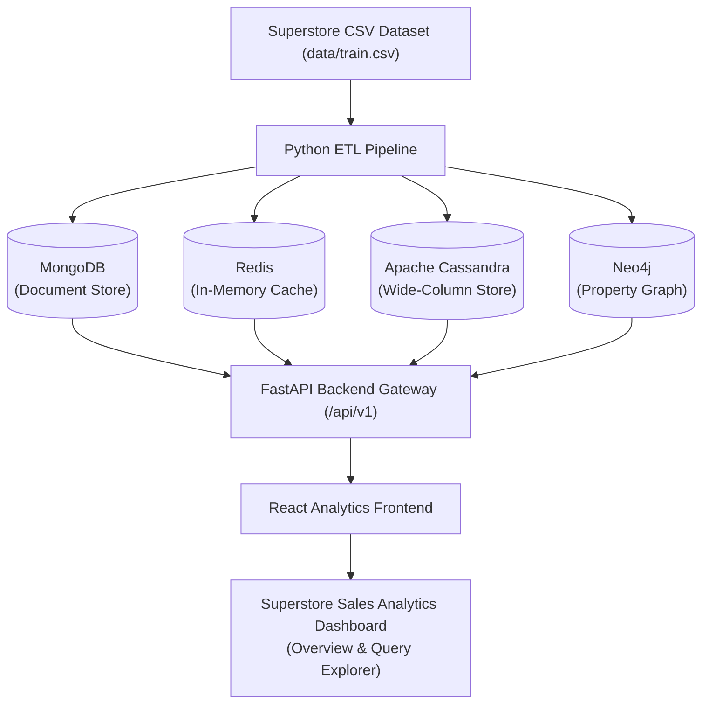
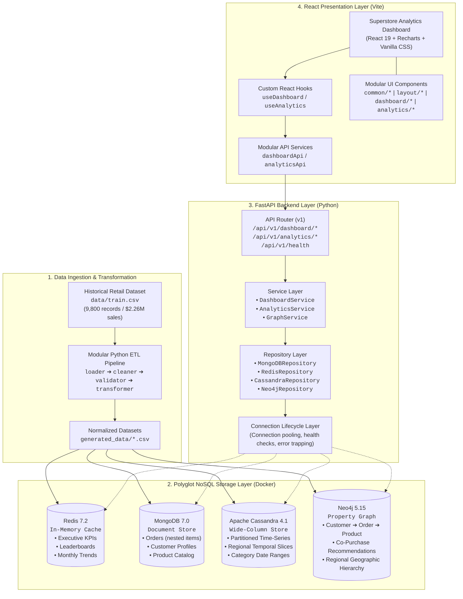
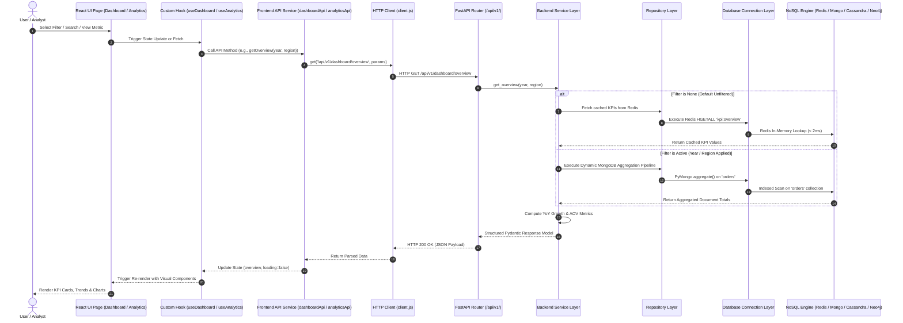

# System Architecture & Technical Design

## 1. Executive Summary

The **Multi-NoSQL Real-Time Business Analytics Platform** (Superstore Sales Analytics) is an enterprise-grade polyglot persistence analytics platform engineered to process, aggregate, and visualize retail sales data. The platform ingests 9,800 transactional line items across 4,922 orders from the historical US Superstore retail dataset (2015–2018) and distributes the workload across four distinct NoSQL database paradigms:

1. **Redis**: In-Memory Key-Value & Sorted-Set Cache for sub-millisecond executive KPI retrieval.
2. **MongoDB**: Document Database for rich, nested transactional order and customer profiles.
3. **Apache Cassandra**: Distributed Wide-Column Store for partition-optimized temporal time-series queries.
4. **Neo4j**: Labeled Property Graph Database for multi-hop customer journeys and product co-purchase affinities.

---

## 2. High-Level Architecture Diagrams

### 2.1 Simplified Polyglot Architecture Diagram



---

### 2.2 Detailed Polyglot Architecture Diagram



---

## 3. End-to-End Request & Data Flow Diagram



---

## 4. Database Workload Segregation

No single database engine satisfies all modern analytics access patterns without significant performance compromises. This architecture assigns each database an explicit, mathematically sound role:

| Database Engine | Data Model | Primary Role & Access Pattern | Typical Latency | Key Optimization Strategy |
| :--- | :--- | :--- | :--- | :--- |
| **Redis** | In-Memory Key-Value & Sorted Sets | Executive KPI cards, sales aggregates, and top leaderboard rankings. | < 5 ms | Precomputed hashes, Sorted Sets for rank queries, memory eviction safety. |
| **MongoDB** | Document (JSON-like BSON) | Operational drill-downs: order details with embedded line items, customer histories, and text prefix autocomplete. | 10–30 ms | Compound B-tree indexes on `order_id`, `customer_id`, and `product_id`. |
| **Apache Cassandra** | Wide-Column Family | Time-series aggregations, chronological sales queries by date, region-date, and category-date ranges. | 15–40 ms | Query-first data modeling with composite partition keys and clustering order. |
| **Neo4j** | Labeled Property Graph | Multi-hop relationship traversals: co-purchasing ("frequently bought together") and geographic hierarchy. | 25–60 ms | Index-free adjacency, Cypher pattern matching, schema uniqueness constraints. |

---

## 5. Backend Responsibility Separation

The backend follows a strict 4-layer unidirectional responsibility flow:

```text
API Router Layer (FastAPI)
       ↓
Service Layer (Business Logic & Orchestration)
       ↓
Repository Layer (Database Query & Data Retrieval)
       ↓
Database Connection Layer (Connection Pooling & Lifecycle)
       ↓
Physical NoSQL Databases
```

### 1. API Router Layer (`app/api/v1/`)
- Responsible strictly for HTTP protocols, path routing, query parameter parsing, and response status codes.
- Implements versioned routes under `/api/v1/`.
- No database client imports, SQL/CQL queries, or aggregation logic reside here.

### 2. Service Layer (`app/services/`)
- Orchestrates multi-repository workflows (e.g., fallback to MongoDB if Redis cache misses, or calculating Year-over-Year percentage changes).
- Transforms raw database tuples and documents into structured Pydantic response models.
- Contains all domain business rules.

### 3. Repository Layer (`app/repositories/`)
- Encapsulates database-specific query syntax (PyMongo filters, Redis pipelines, Cassandra CQL statements, Neo4j Cypher scripts).
- Handles low-level cursor iteration, schema mapping, and data normalization.
- Does not depend on FastAPI or HTTP concepts.

### 4. Database Connection Layer (`app/databases/`)
- Manages connection creation, persistent connection pools, graceful shutdown hooks, and diagnostic health ping checks.

---

## 6. Frontend Architecture

The frontend is constructed using **React + Vite** with a modular component hierarchy and strict separation of concerns:

```text
React Pages (Dashboard, Analytics)
       ↓
Custom React Hooks (useDashboard, useAnalytics)
       ↓
API Services (dashboardApi, analyticsApi)
       ↓
HTTP Client (client.js with AbortController timeout & error handling)
       ↓
FastAPI Backend Gateway (/api/v1/)
```

- **Environment Config (`src/config/environment.js`)**: Dynamic base URL resolution using `import.meta.env.VITE_API_BASE_URL`.
- **API Client Layer (`src/services/api/`)**: Centralized HTTP client (`client.js`) handling timeout abort controllers and JSON error unpacking, wrapped by specialized service modules (`dashboardApi.js`, `analyticsApi.js`).
- **Custom Hooks (`src/hooks/`)**: `useDashboard` orchestrates multi-panel data loading, filter synchronizations, and loading states; `useAnalytics` tracks query latency and active query sections.
- **Component Design System (`src/components/`)**:
  - `common/`: `LoadingState`, `ErrorState`, `EmptyState`, `DataTable`.
  - `layout/`: `Header`, `Sidebar`.
  - `dashboard/`: `KpiCard`, `ChartCard`.
  - `analytics/`: `QueryResult`.
