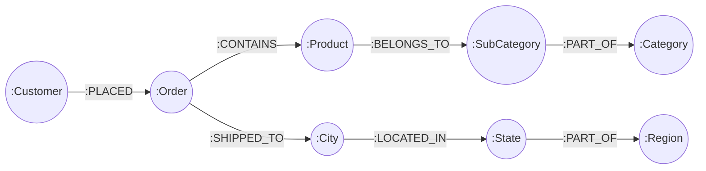

# Polyglot Database Design & Schema Architecture

## 1. Polyglot Persistence Rationale

Modern retail analytics platforms present fundamentally conflicting data access requirements:
1. **Executive Dashboards**: Demand sub-millisecond retrieval of pre-aggregated KPIs without scanning millions of operational rows.
2. **Operational Drill-Downs**: Require flexible, semi-structured document models with embedded line items and atomic ACID updates.
3. **Time-Series Analysis**: Demands sequential partition range scans across chronological date slices without expensive table joins.
4. **Relationship & Affinity Discovery**: Demands index-free adjacency graph traversals across multi-hop customer purchase paths.

To eliminate bottlenecks, this platform implements **Polyglot Persistence**, assigning each workload to the optimal NoSQL storage engine:

```text
┌────────────────────────────────────────────────────────────────────────┐
│                        US Superstore Dataset                           │
│             (9,800 Line Items · 4,922 Orders · $2,261,536.78)          │
└───────────────────────────────────┬────────────────────────────────────┘
                                    │
         ┌──────────────────────────┼──────────────────────────┐
         ▼                          ▼                          ▼
┌──────────────────┐       ┌──────────────────┐       ┌──────────────────┐
│      Redis       │       │     MongoDB      │       │ Apache Cassandra │
│ In-Memory Cache  │       │  Document Store  │       │ Wide-Column DB   │
│ • Executive KPIs │       │ • Orders (nested)│       │ • Partition Date │
│ • Leaderboards   │       │ • Customers      │       │ • Regional Range │
│ • Monthly Trends │       │ • Search Indices │       │ • Category Slices│
└──────────────────┘       └──────────────────┘       └──────────────────┘
                                    │
                                    ▼
                           ┌──────────────────┐
                           │      Neo4j       │
                           │  Property Graph  │
                           │ • Co-Purchases   │
                           │ • Customer Paths │
                           │ • Geo Hierarchy  │
                           └──────────────────┘
```

---

## 2. MongoDB Document Store

- **Engine**: MongoDB 7.0
- **Database**: `business_analytics`
- **Primary Role**: Operational transactional store, customer profiles, order item drill-downs, and text prefix search.

### Collection: `orders`
Uses the **Embedded Document Pattern** to store complete order documents with their associated line items. This provides single-read atomic retrieval of an entire receipt without multi-table joins.

```json
{
  "_id": "CA-2017-152156",
  "order_id": "CA-2017-152156",
  "order_date": "2017-11-08",
  "ship_date": "2017-11-11",
  "ship_mode": "Second Class",
  "customer": {
    "customer_id": "CG-12520",
    "customer_name": "Claire Gute",
    "segment": "Consumer"
  },
  "location": {
    "city": "Henderson",
    "state": "Kentucky",
    "region": "South",
    "postal_code": "42420"
  },
  "items": [
    {
      "row_id": 1,
      "product_id": "FUR-BO-10001798",
      "product_name": "Bush Somerset Collection Bookcase",
      "category": "Furniture",
      "sub_category": "Bookcases",
      "sales": 261.96
    },
    {
      "row_id": 2,
      "product_id": "FUR-CH-10000454",
      "product_name": "Hon Deluxe Stacking Chairs",
      "category": "Furniture",
      "sub_category": "Chairs",
      "sales": 731.94
    }
  ],
  "total_sales": 993.90,
  "item_count": 2
}
```

### Collection: `customers`
Stores customer entity records with pre-aggregated order counts and total spend:

```json
{
  "_id": "CG-12520",
  "customer_id": "CG-12520",
  "customer_name": "Claire Gute",
  "segment": "Consumer",
  "total_orders": 3,
  "total_spent": 1148.40
}
```

### Indexing Strategy
- `orders`: `{"order_id": 1}` (Unique), `{"customer.customer_id": 1}`, `{"order_date": 1}`, `{"location.region": 1}`.
- `customers`: `{"customer_id": 1}` (Unique), `{"customer_name": "text"}`.
- `products`: `{"product_id": 1}` (Unique), `{"category": 1}`, `{"sub_category": 1}`.

---

## 3. Redis In-Memory Cache

- **Engine**: Redis 7.2
- **Primary Role**: High-speed caching of executive KPI cards, precomputed monthly sales aggregates, and revenue leaderboards.

### Key Naming Conventions & Data Structures

| Key Pattern | Redis Data Structure | Description | TTL |
| :--- | :--- | :--- | :--- |
| `kpi:overview` | **Hash (`HSET`)** | Executive metrics: `total_sales`, `total_orders`, `total_customers`, `total_products`. | 3600s |
| `analytics:monthly_sales` | **String (JSON)** | Chronological array of monthly sales across 2015–2018. | 3600s |
| `analytics:regions` | **String (JSON)** | Breakdown of sales and order volume by region (`West`, `East`, `Central`, `South`). | 3600s |
| `analytics:categories` | **String (JSON)** | Sales volume by product category. | 3600s |
| `analytics:segments` | **String (JSON)** | Sales volume by customer segment. | 3600s |
| `analytics:shipping` | **String (JSON)** | Sales volume and order counts by shipping mode. | 3600s |
| `leaderboard:products` | **Sorted Set (`ZSET`)** | Member: `product_id`, Score: `total_sales`. Supports `ZREVRANGE` for top N products in O(log(N) + M). | 3600s |
| `leaderboard:customers` | **Sorted Set (`ZSET`)** | Member: `customer_id`, Score: `total_spend`. Supports O(log(N) + M) rank lookups. | 3600s |

---

## 4. Apache Cassandra Wide-Column Store

- **Engine**: Apache Cassandra 4.1
- **Keyspace**: `business_analytics`
- **Replication Strategy**: `{'class': 'SimpleStrategy', 'replication_factor': 1}`
- **Primary Role**: Query-driven time-series storage partitioned for partition-pruned range queries.

### Query-First Denormalization
In Cassandra, schemas are strictly designed around exact application queries rather than relational normalization.

#### Table: `sales_by_date`
Optimized for: *“Get all sales transactions for an exact date”*.
```sql
CREATE TABLE business_analytics.sales_by_date (
    order_date text,
    order_id text,
    line_item_id int,
    customer_id text,
    customer_name text,
    product_id text,
    product_name text,
    category text,
    sub_category text,
    region text,
    sales double,
    PRIMARY KEY ((order_date), order_id, line_item_id)
);
```
- **Partition Key**: `order_date` — Locates all line items for that single calendar day on a single storage node.
- **Clustering Key**: `order_id, line_item_id` — Uniquely identifies each line item within the date partition.

#### Table: `sales_by_region_date`
Optimized for: *“Get chronological sales in a region between date A and date B”*.
```sql
CREATE TABLE business_analytics.sales_by_region_date (
    region text,
    order_date text,
    order_id text,
    line_item_id int,
    sales double,
    category text,
    PRIMARY KEY ((region), order_date, order_id, line_item_id)
) WITH CLUSTERING ORDER BY (order_date DESC, order_id ASC, line_item_id ASC);
```
- **Partition Key**: `region` — Distributes load evenly across nodes based on geographic regions.
- **Clustering Key**: `order_date DESC` — Enables sequential range slice scans without table scans.

#### Table: `sales_by_category_date`
Optimized for: *“Get chronological sales for a product category across a date window”*.
```sql
CREATE TABLE business_analytics.sales_by_category_date (
    category text,
    order_date text,
    order_id text,
    line_item_id int,
    sales double,
    region text,
    PRIMARY KEY ((category), order_date, order_id, line_item_id)
) WITH CLUSTERING ORDER BY (order_date DESC, order_id ASC, line_item_id ASC);
```

---

## 5. Neo4j Property Graph Database

- **Engine**: Neo4j 5.15 Community Edition
- **Primary Role**: Entity relationship modeling, customer order journeys, co-purchasing recommendations, and multi-hop regional hierarchy traversals.

### Graph Schema Model



### Node Counts & Constraints

| Node Label | Count | Unique Constraint Property |
| :--- | :--- | :--- |
| `Customer` | 793 | `customer_id` |
| `Order` | 4,922 | `order_id` |
| `Product` | 1,861 | `product_id` |
| `Category` | 3 | `name` (`Technology`, `Furniture`, `Office Supplies`) |
| `SubCategory`| 17 | `name` (`Phones`, `Chairs`, `Storage`, etc.) |
| `City` | 529 | `name` |
| `State` | 49 | `name` |
| `Region` | 4 | `name` (`West`, `East`, `Central`, `South`) |

### Key Graph Traversals (Cypher)

#### Product Co-Purchasing Recommendation
Finds other products purchased in the same orders as target product `P`:
```cypher
MATCH (p:Product {product_id: $product_id})<-[:CONTAINS]-(o:Order)-[:CONTAINS]->(co:Product)
WHERE p <> co
RETURN co.product_id AS product_id,
       co.product_name AS product_name,
       count(DISTINCT o) AS copurchase_count
ORDER BY copurchase_count DESC
LIMIT $limit;
```

#### Multi-Hop Regional Category Distribution
Traverses 6 hops from `Region` through geographic hierarchy and orders to product `Category`:
```cypher
MATCH (r:Region {name: $region})<-[:PART_OF]-(:State)<-[:LOCATED_IN]-(:City)<-[:SHIPPED_TO]-(o:Order)-[:CONTAINS]->(p:Product)-[:BELONGS_TO]->(:SubCategory)-[:PART_OF]->(c:Category)
RETURN c.name AS category,
       round(sum(p.sales), 2) AS sales
ORDER BY sales DESC;
```

---

## 6. Dataset Reconciliation & Verification Benchmark

Across all four databases, the ETL pipeline guarantees complete data consistency. The following benchmark values must remain exact:

- **Total Recorded Sales**: `$2,261,536.7827`
- **Total Orders**: `4,922`
- **Total Line Items**: `9,800`
- **Total Customers**: `793`
- **Total Products**: `1,861`
- **Supported Fields Only**: `Sales`, `Order Date`, `Ship Date`, `Ship Mode`, `Customer`, `Product`, `Category`, `SubCategory`, `Location`.
- **Excluded Fields**: No `Profit`, `Quantity`, `Discount`, `Cost`, or derived `Margin` fields are introduced or fabricated.
