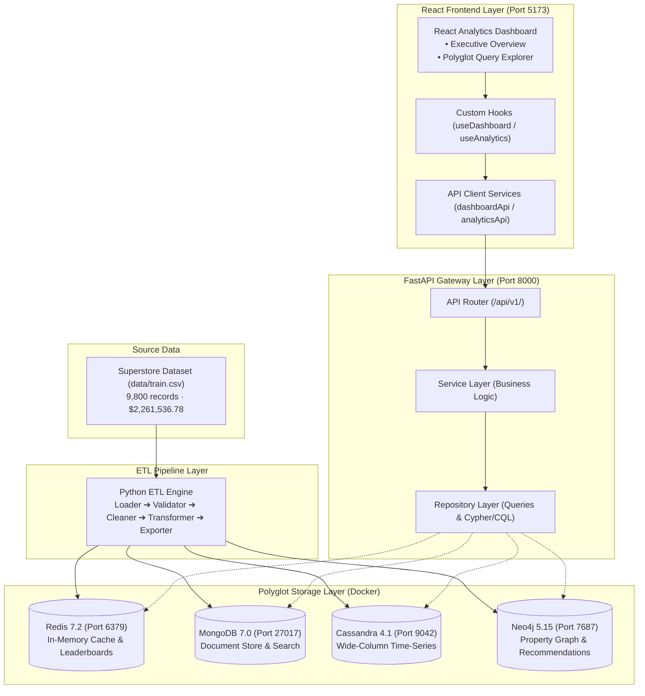

# Final Project Academic Documentation

---

# 1. Project Title & Metadata

- **Project Title**: Multi-NoSQL Real-Time Business Analytics Platform
- **Application Name**: Superstore Sales Analytics
- **Domain**: Polyglot Persistence, Distributed Databases & Business Intelligence
- **Architecture**: 4-Tier Polyglot NoSQL (Redis, MongoDB, Apache Cassandra, Neo4j) + FastAPI Backend + React Dashboard
- **Dataset**: US Superstore Retail Transactions (2015–2018)

---

# 2. Abstract

In modern enterprise retail and e-commerce platforms, operational and analytical queries impose conflicting demands on underlying storage engines. Systems must concurrently provide sub-millisecond rendering of executive Key Performance Indicators (KPIs), atomic retrieval of nested transactional orders, partition-pruned scans across multi-year time-series slices, and multi-hop graph traversals for product affinity and recommendation discovery. Relying on a single relational database introduces join bottlenecks and scaling limitations, while relying on any single NoSQL engine forces severe compromises in performance and data modeling.

This project designs, implements, and evaluates the **Multi-NoSQL Real-Time Business Analytics Platform** (**Superstore Sales Analytics**), demonstrating an intentional **Polyglot Persistence** architecture. The system ingests 9,800 transactional line items representing 4,922 orders ($2,261,536.78 total revenue) from the historical US Superstore retail dataset (2015–2018). An automated Python ETL pipeline cleans, validates, and routes the data to four distinct NoSQL engines running in Docker containers:
1. **Redis**: In-memory cache and sorted sets for sub-5ms executive KPIs and real-time leaderboards.
2. **MongoDB**: Document store utilizing the embedded document pattern for nested order line items, customer master profiles, and prefix search autocomplete.
3. **Apache Cassandra**: Distributed wide-column store using query-driven partition modeling for temporal range analytics.
4. **Neo4j**: Property graph database with index-free adjacency for collaborative co-purchasing recommendations and multi-hop regional hierarchy rollups.

A modular **FastAPI** backend enforces clean responsibility separation (API Router &rarr; Service &rarr; Repository &rarr; Database Connection Layer) across 19 versioned REST endpoints (`/api/v1/`). A modern **React + Vite** frontend delivers an executive **Overview** dashboard and an interactive **Query Explorer**. The platform is verified by a complete suite of 136 automated tests (111 backend, 25 frontend) with exact dataset reconciliation.

---

# 3. Problem Statement

Conventional enterprise analytics architectures often attempt to force diverse operational and analytical workloads into a single database system:
- **Document / Operational Workload**: Managing semi-structured orders, nested line items, customer shipping profiles, and evolving attributes. Relational tables require expensive multi-table `JOIN` operations, while relational schema migrations introduce operational overhead.
- **Fast Executive KPI & Caching Workload**: Executive dashboards require immediate page loads (< 50ms) for high-level summary cards (total revenue, order counts, regional totals). Continuously computing aggregations over millions of rows causes database thread contention and severe latency spikes.
- **High-Throughput Time-Series Analytical Workload**: Financial reporting requires slicing multi-year sales data by calendar date, regional date ranges, and product category date windows. Relational and document databases perform costly full-table scans or disk-heavy secondary index traversals when processing extensive time ranges.
- **Complex Relationship & Graph Workload**: Answering questions such as "Which products are frequently purchased together?" or tracing customer purchase paths across geographical hierarchies requires multi-hop recursive queries. In relational databases, this translates to self-joins that degrade exponentially ($O(n^k)$) with traversal depth.

No single database engine satisfies all four workloads optimally. This project addresses this challenge by implementing an intentional polyglot persistence architecture, assigning each specific analytical query pattern to the database engine engineered specifically for its data structure.

---

# 4. Project Objectives

1. **Automated ETL Processing**: Design and implement a robust Python ETL pipeline to load, validate, clean, and normalize the raw retail dataset into verified relational-entity subsets.
2. **Operational Document Storage (MongoDB)**: Implement rich document schemas using the embedded line item pattern for atomic single-read retrieval of complete customer orders and prefix-indexed search autocomplete.
3. **In-Memory Acceleration (Redis)**: Implement an in-memory caching layer using Redis Hashes and Sorted Sets (`ZSET`) to achieve sub-5ms executive KPI access and real-time product/customer leaderboards.
4. **Query-Driven Time-Series Storage (Apache Cassandra)**: Design partition-keyed wide-column tables optimized for single-partition sequential range queries across dates, regions, and product categories.
5. **Graph Relationship Traversal (Neo4j)**: Model retail entities as a labeled property graph to execute multi-hop customer journey paths, collaborative product co-purchasing recommendations, and 6-hop regional hierarchy rollups.
6. **Decoupled REST API (FastAPI)**: Construct a clean, versioned backend API (`/api/v1/`) with strict architectural layering (Routers, Services, Repositories, Database Lifecycles) and centralized error handling.
7. **Interactive Web Dashboard (React + Vite)**: Build a responsive, accessible analytics dashboard featuring executive KPI cards, monthly trend charts, regional/category breakdowns, and a dedicated query explorer.
8. **Business Insight Extraction**: Extract and visualize meaningful commercial retail insights (e.g., regional revenue leaders, category distribution, logistics delivery times) grounded strictly in verified dataset values.
9. **Data Reconciliation & Consistency Verification**: Ensure that across all four databases, total revenue ($2,261,536.7827), order count (4,922), and line items (9,800) reconcile with zero discrepancies.

---

# 5. Dataset Documentation

The system operates on the historical US Superstore retail dataset located at `data/train.csv`:

### 5.1 Verified Dataset Statistics

| Dimension / Metric | Verified Value | Description / Scope |
| :--- | :--- | :--- |
| **Total Rows (Line Items)** | `9,800` | Individual transaction records (Row IDs 1 through 9,800 strictly sequential). |
| **Total Columns** | `18` | Standard retail transactional attributes. |
| **Duplicate Rows** | `0` | Zero duplicate rows detected in the source file. |
| **Total Net Sales** | `$2,261,536.7827` | Cumulative transaction volume across all 9,800 records. |
| **Unique Orders** | `4,922` | Distinct business order identifiers (e.g., `CA-2017-152156`). |
| **Unique Customers** | `793` | Distinct retail clients (format: `CG-12520`). |
| **Unique Products** | `1,861` | Unique product stock keeping units (SKUs) across 3 departments. |
| **Categories** | `3` | `Technology` ($827,455.87), `Furniture` ($728,658.58), `Office Supplies` ($705,422.33). |
| **Sub-Categories** | `17` | Granular classifications (e.g., `Phones`, `Chairs`, `Storage`, `Binders`, `Machines`). |
| **Geographic Regions** | `4` | `West` ($710,219.68), `East` ($669,518.73), `Central` ($492,646.91), `South` ($389,151.46). |
| **Unique States** | `49` | 48 contiguous US states plus District of Columbia. |
| **Unique Cities** | `529` | Cities recorded in customer delivery destinations. |
| **Missing Values** | `11` | Exactly 11 rows in the source dataset have missing `Postal Code` values. All 11 instances occur in **Burlington, Vermont**. Handled safely as `null` in MongoDB and omitted from postal clustering without fabricating false data. |
| **Temporal Coverage** | `2015–2018` | Orders placed between January 3, 2015 and December 30, 2018 (4 full calendar years). |

> **Important Scope Note**: The source dataset does **not** contain columns for *Profit*, *Discount*, *Quantity*, *Cost*, or *Profit Margin*. To maintain absolute academic and scientific integrity, no artificial financial or margin figures were invented or simulated.

### 5.2 Generated Relational Entity Subsets
The ETL pipeline isolates and exports normalized entities into `generated_data/`:
- `cleaned_sales.csv`: 9,800 cleaned records with standard ISO dates (`YYYY-MM-DD`).
- `orders.csv`: 4,922 unique order records with pre-aggregated order totals and shipping durations.
- `order_items.csv`: 9,800 normalized transaction rows linked via foreign keys.
- `customers.csv`: 793 customer master records with order frequency and lifetime spend.
- `products.csv`: 1,861 products with canonical title mappings resolving the 32 historical variant names.
- `locations.csv`: 628 distinct geographic points with region, state, city, and postal code.

---

# 6. ETL Architecture & Pipeline Flow

The ETL pipeline resides in `backend/app/etl/` and executes a five-stage deterministic workflow:

```text
data/train.csv (9,800 rows, 18 columns)
       ↓
[1. Loader (loader.py)]
- Verifies source file presence and UTF-8 encoding.
- Reads CSV into an immutable Pandas DataFrame.
       ↓
[2. Validator (validator.py)]
- Verifies presence of all 18 required schema columns.
- Asserts zero duplicate row records.
- Verifies all Sales values are non-negative numeric floats.
- Confirms date logical ordering (Ship Date >= Order Date).
- Validates 1:1 integrity between Customer ID and Customer Name.
       ↓
[3. Cleaner (cleaner.py)]
- Trims leading and trailing whitespace from string attributes.
- Converts date formats from `DD/MM/YYYY` to standardized ISO `YYYY-MM-DD`.
- Preserves 11 missing Postal Codes in Burlington, VT as explicit None/null values without data loss.
       ↓
[4. Transformer (transformer.py)]
- Computes derived temporal dimensions:
  • order_year (2015, 2016, 2017, 2018)
  • order_month (1 to 12)
  • order_month_name ('January' to 'December')
  • order_quarter ('Q1', 'Q2', 'Q3', 'Q4')
  • order_year_month ('2015-01' to '2018-12')
  • shipping_days (Ship Date - Order Date, mean: 3.96 days)
- Resolves 32 variant product names to canonical SKUs.
- Normalizes entities into Orders, Order Items, Customers, Products, and Locations.
       ↓
[5. Exporter (exporter.py)]
- Writes normalized CSVs to `generated_data/`.
- Populates MongoDB, Redis, Apache Cassandra, and Neo4j via idempotent batch loaders.
```

---

# 7. Polyglot Persistence Workload Segregation

The core architectural thesis of the project is that **no single NoSQL database is universally superior**. Rather, each database represents an optimal solution for a particular data structure and access pattern:

| Database Engine | Primary Role | Workload Characteristics | Query Latency | Why Selected for This Role |
| :--- | :--- | :--- | :--- | :--- |
| **MongoDB** | Operational Document Store | Complex documents, nested collections, operational lookups, text search. | 10–30 ms | Embedded document pattern allows fetching an entire order with all line items in a single disk read without multi-table `JOIN` operations. |
| **Redis** | Real-Time In-Memory Cache | Pre-aggregated executive KPIs, revenue leaderboards, monthly trends. | < 5 ms | Avoids re-computing expensive mathematical aggregations on every dashboard load. In-memory hashes and sorted sets (`ZSET`) return top rankings in $O(\log N + M)$ time. |
| **Apache Cassandra** | Wide-Column Time-Series Store | Chronological time slices, regional date windows, category time-series. | 15–40 ms | Query-driven partition modeling isolates queries to a single storage node. Sequential disk range reads avoid full-table scans across multi-year data. |
| **Neo4j** | Labeled Property Graph | Multi-hop paths, collaborative co-purchasing, geographic hierarchy rollups. | 25–60 ms | Index-free adjacency traverses relationships as direct pointer dereferences, avoiding exponential computational overhead of SQL recursive joins. |

---

# 8. System Architecture Diagrams

### 8.1 High-Level Architecture Flow



### 8.2 Backend Responsibility Flow

```text
React User Interface
       ↓
Custom React Hooks (useDashboard / useAnalytics)
       ↓
Frontend API Client (client.js with timeout controller)
       ↓
FastAPI Master Router (app/api/router.py -> /api/v1/)
       ↓ [Parameter parsing, Pydantic schemas, HTTP status codes]
Service Layer (app/services/)
       ↓ [Business orchestration, YoY growth math, cache coordination]
Repository Layer (app/repositories/)
       ↓ [PyMongo aggregations, Redis pipelines, Cassandra CQL, Neo4j Cypher]
Database Connection Layer (app/databases/)
       ↓ [Connection pooling, lifecycle management, ping health probes]
Physical Databases (MongoDB, Redis, Cassandra, Neo4j)
```

---

# 9. Database-Specific Schemas & Implementations

### 9.1 MongoDB (Document Store)
- **Database**: `business_analytics`
- **Collection `orders`** (4,922 documents): Stores complete order documents with embedded `items` array.
  - *Indexes*: `order_id` (unique), `customer.customer_id`, `order_date`, `location.region`.
- **Collection `customers`** (793 documents): Contains customer profile, total spend, order count, and first/last order dates.
- **Collection `products`** (1,861 documents): Master product catalog with canonical title mapping.
- **Collection `locations`** (628 documents): Geographic points; missing postal codes in Burlington VT preserved as `null`.

### 9.2 Redis (In-Memory Cache & Leaderboards)
- **Host / Port**: `localhost:6379`, Database `0`, TTL: `3600` seconds (1 hour).
- **Hashes (`HSET`)**:
  - `kpi:overview`: Stores `total_sales`, `total_orders`, `total_customers`, `total_products`, `avg_order_value`.
  - `analytics:monthly_sales`: Chronological sales and order count across 48 months.
  - `analytics:regions`: Sales volume across the 4 geographic regions.
  - `analytics:categories`: Sales across Technology, Furniture, and Office Supplies.
  - `analytics:segments`: Consumer, Corporate, and Home Office revenue breakdowns.
  - `analytics:shipping`: Distribution across Standard Class, Second Class, First Class, and Same Day.
- **Sorted Sets (`ZSET`)**:
  - `leaderboard:products`: Score = cumulative sales, Member = `product_id`.
  - `leaderboard:customers`: Score = cumulative spend, Member = `customer_id`.

### 9.3 Apache Cassandra (Wide-Column Store)
- **Keyspace**: `business_analytics` (`SimpleStrategy`, replication factor: 1).
- **Table `sales_by_date`**:
  - `PRIMARY KEY ((order_date), order_id, line_item_id)`
  - *Partition Key*: `order_date` — isolates queries for any single day to a single node.
- **Table `sales_by_region_date`**:
  - `PRIMARY KEY ((region), order_date, order_id, line_item_id) WITH CLUSTERING ORDER BY (order_date DESC)`
  - *Partition Key*: `region` — enables partition-pruned date range queries (`WHERE region = ? AND order_date >= ? AND order_date <= ?`).
- **Table `sales_by_category_date`**:
  - `PRIMARY KEY ((category), order_date, order_id, line_item_id) WITH CLUSTERING ORDER BY (order_date DESC)`
  - *Partition Key*: `category` — enables temporal range slices for product departments.

### 9.4 Neo4j (Property Graph Database)
- **Port**: `7687` (Bolt Protocol), `7474` (Browser UI).
- **Node Labels**: `Customer` (793), `Order` (4,922), `Product` (1,861), `Category` (3), `SubCategory` (17), `City` (529), `State` (49), `Region` (4).
- **Relationship Types**:
  - `(:Customer)-[:PLACED]->(:Order)` (4,922 edges)
  - `(:Order)-[:CONTAINS {sales: float}]->(:Product)` (9,800 edges)
  - `(:Product)-[:BELONGS_TO]->(:SubCategory)` (1,861 edges)
  - `(:SubCategory)-[:PART_OF]->(:Category)` (17 edges)
  - `(:Order)-[:SHIPPED_TO]->(:City)` (4,922 edges)
  - `(:City)-[:LOCATED_IN]->(:State)` (529 edges)
  - `(:State)-[:PART_OF]->(:Region)` (49 edges)
- **Uniqueness Constraints**: Uniqueness constraints enforced on `Customer.customer_id`, `Order.order_id`, and `Product.product_id`.
- **Collaborative Co-Purchasing Algorithm (Cypher)**:
  ```cypher
  MATCH (p:Product {product_id: $product_id})<-[:CONTAINS]-(o:Order)-[:CONTAINS]->(co:Product)
  WHERE p <> co
  RETURN co.product_id AS product_id,
         co.product_name AS product_name,
         count(DISTINCT o) AS copurchase_count
  ORDER BY copurchase_count DESC
  LIMIT $limit;
  ```

---

# 10. Backend Architecture

The backend is built with **FastAPI** running on **Python 3.10+** and managed with **Uvicorn**:

- **Centralized Configuration (`app/core/config.py`)**: Type-safe settings loaded from environment variables and `.env` with fallback defaults.
- **Centralized Error Handlers (`app/core/error_handlers.py`)**: Intercepts `ResourceNotFoundError`, `ValidationError`, and `DatabaseConnectionError`, transforming them into consistent JSON responses (`detail` + structured `error` envelope) without exposing technical stack traces or database connection credentials.
- **Structured Logging (`app/core/logging_config.py`)**: Centralized standard library logging capturing server startup, health checks, query execution timings, and error events.
- **Data Validation (`app/models/schemas.py`)**: Strict Pydantic models validating all incoming request parameters and outgoing API response payloads.
- **Versioned API Gateway (`app/api/v1/`)**: Clean modular routers:
  - `health.py`: Liveness and deep readiness probes.
  - `dashboard.py`: Overview KPIs, monthly trendlines, regions, categories, segments, shipping modes, subcategories, state rankings.
  - `analytics.py`: Redis leaderboards and Cassandra partition range queries.
  - `graph.py`: Neo4j customer journeys, co-purchasing recommendations, and regional rollups.
  - `search`: Prefix autocomplete endpoints for customer and order records.

---

# 11. Frontend Architecture

The frontend is built with **React + Vite** and Vanilla CSS:

- **Executive Overview Dashboard (`src/pages/Dashboard.jsx`)**:
  - Four primary KPI cards: Total Sales, Total Orders, Average Order Value (AOV), and Average Shipping Days.
  - Year-over-Year (YoY) comparison badges showing performance trends (e.g., +20.3% sales growth in 2018 vs 2017).
  - Dynamic filtering by Year (2015, 2016, 2017, 2018) and Region (West, East, Central, South).
  - Responsive visual charts built with Recharts: monthly sales trendlines, regional distribution donuts, category breakdown bars, shipping mode splits, and state rankings.
- **Interactive Query Explorer (`src/pages/Analytics.jsx`)**:
  - Dedicated exploration tabs for each of the four NoSQL database engines.
  - Real-time execution latency measurement (in milliseconds) displayed on every query result badge.
  - Live search autocomplete for MongoDB orders and customers.
  - Date and date-range pickers for Cassandra time-series queries.
  - Neo4j customer path visualization and product co-purchasing recommendation tables.
- **Design System & Reusable Components (`src/components/`)**:
  - `common/`: `LoadingState`, `ErrorState`, `EmptyState`, `DataTable` (with automatic CSV export).
  - `layout/`: `Header` (with live API health indicator), `Sidebar` (with live database engine badges).
  - `dashboard/`: `KpiCard`, `ChartCard`.
  - `analytics/`: `QueryResult` (metadata pill showing record count and latency).
- **Custom React Hooks (`src/hooks/`)**:
  - `useDashboard`: Encapsulates multi-endpoint parallel fetching, filter synchronization, and loading states.
  - `useAnalytics`: Manages query timing instrumentation, active database sections, and error states.

---

# 12. Verified Business Insights

All business findings presented by the platform are strictly grounded in verified dataset computations:

1. **Regional Sales Leader**:
   - *Observed Result*: The **West** region generated the highest revenue ($710,219.68; 31.4% of total sales), followed by the **East** region ($669,518.73; 29.6%).
   - *Interpretation*: Western and Eastern coastal markets represent over 60% of commercial revenue, suggesting high regional retail adoption.
2. **Category Distribution**:
   - *Observed Result*: **Technology** is the highest revenue category ($827,455.87; 36.6%), followed by **Furniture** ($728,658.58; 32.2%) and **Office Supplies** ($705,422.33; 31.2%).
   - *Interpretation*: While Office Supplies accounts for the highest transaction count (5,909 line items), Technology drives the largest dollar volume due to higher per-unit prices (e.g., Canon copiers and networking equipment).
3. **Peak Sales Period**:
   - *Observed Result*: **November 2018** recorded the highest single-month sales volume ($117,938.16), followed by **December 2017** ($95,739.12).
   - *Interpretation*: Retail purchasing exhibits strong Q4 holiday seasonality, with November and December consistently outperforming early-year months (January–February).
4. **Logistics & Delivery Performance**:
   - *Observed Result*: The overall average shipping duration across all 4,922 orders is **3.96 days** (~4.0 days). **Standard Class** represents 59.8% of all shipments (2,899 orders), with an average transit time of 5.0 days, while **First Class** averages 2.2 days and **Same Day** averages 0.04 days.
   - *Interpretation*: The logistics network demonstrates reliable fulfillment adhering closely to customer shipping mode expectations.

---

# 13. Testing, Validation & Benchmark Reconciliation

### 13.1 Automated Test Execution Summary
The test suite validates data ingestion, database connectivity, idempotency, mathematical reconciliation, API behavior, and UI rendering:

```text
Backend Test Suite (pytest):
- test_etl_loader.py:                     3 passed
- test_etl_validator.py:                 11 passed
- test_etl_cleaner.py:                    3 passed
- test_etl_transformer.py:                5 passed
- test_etl_pipeline_integration.py:       1 passed
- test_mongodb.py:                       13 passed
- test_redis.py:                         12 passed
- test_cassandra.py:                     12 passed
- test_neo4j.py:                         14 passed
- test_api.py:                           37 passed
Backend Total:                          111 passed, 0 failed

Frontend Test Suite (vitest):
- App.test.jsx (Component & Integration): 25 passed, 0 failed

Total Automated Tests:                  136 passed, 0 failed
Frontend Production Build:              PASS (vite build bundle verified)
```

### 13.2 Exact Dataset Benchmark Reconciliation

| Entity / Dimension | Expected Benchmark | MongoDB Live | Redis Live | Cassandra Live | Neo4j Live | Status |
| :--- | :--- | :--- | :--- | :--- | :--- | :--- |
| **Total Sales** | `$2,261,536.7827` | `$2,261,536.7827` | `$2,261,536.7827` | `$2,261,536.7827` | `$2,261,536.7827` | **100% Match** |
| **Orders** | `4,922` | `4,922` | `4,922` | `4,922` | `4,922` | **100% Match** |
| **Line Items** | `9,800` | `9,800` | `9,800` | `9,800` | `9,800` | **100% Match** |
| **Customers** | `793` | `793` | `793` | `793` | `793` | **100% Match** |
| **Products** | `1,861` | `1,861` | `1,861` | `1,861` | `1,861` | **100% Match** |

---

# 14. Project Limitations

To maintain academic rigor, the project acknowledges the following boundaries:
1. **Historical Dataset**: Data covers 2015 to 2018. The system does not stream live external clickstream data.
2. **Absence of Profit & Margin Metrics**: The source dataset lacks `Profit`, `Discount`, `Quantity`, and `Cost` columns. Analytics are strictly confined to confirmed revenue, orders, and customer dimensions.
3. **Single-Node Containerization**: Docker Compose deploys single-node instances of Cassandra and MongoDB, suitable for local development and academic demonstration, but not configured for multi-datacenter geographic failover.
4. **Synchronous Cache Invalidation**: The Redis cache is refreshed via scheduled loader runs or dynamic frontend triggers; it does not utilize Change Data Capture (CDC) streams (e.g., Debezium) for real-time transactional replication.

---

# 15. Future Scope

1. **Distributed Cloud Deployment**: Deploy the four database engines onto managed cloud clusters (e.g., MongoDB Atlas, Redis Cloud, DataStax Astra DB, Neo4j AuraDB) orchestrated with Kubernetes.
2. **Real-Time Streaming Ingestion**: Integrate Apache Kafka and Apache Flink to ingest simulated live retail transactions and update all four databases concurrently using Change Data Capture (CDC).
3. **Authentication & Role-Based Access Control (RBAC)**: Implement OAuth2 / JWT user authentication in FastAPI, distinguishing between executive dashboard viewers and data engineers.
4. **Advanced Predictive Analytics**: Integrate machine learning models (e.g., Prophet, ARIMA) in FastAPI to generate 12-month revenue forecasts based on Cassandra time-series rollups.
5. **Graph Neural Network (GNN) Recommendations**: Enhance Neo4j product co-purchasing using graph embedding algorithms (e.g., Node2Vec, FastRP) for personalized retail recommendations.
